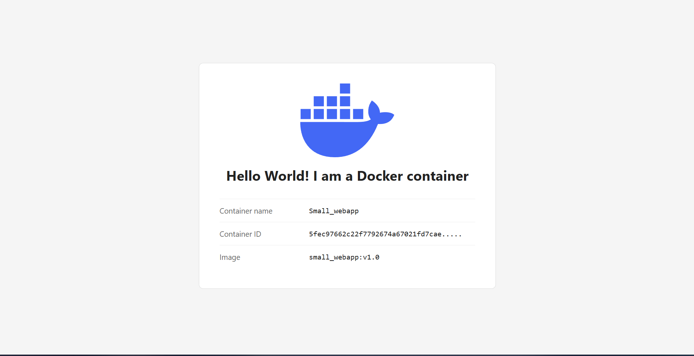
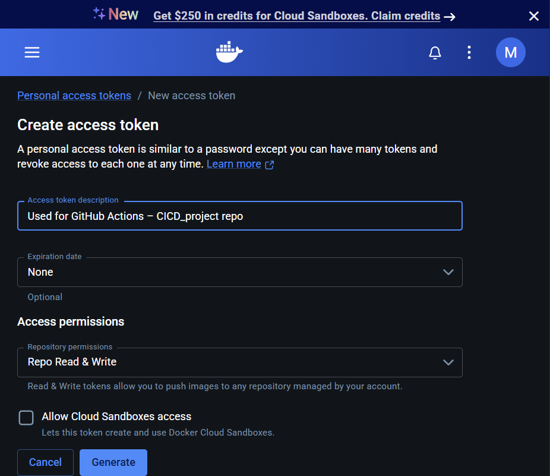
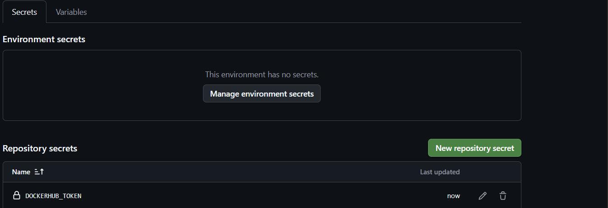
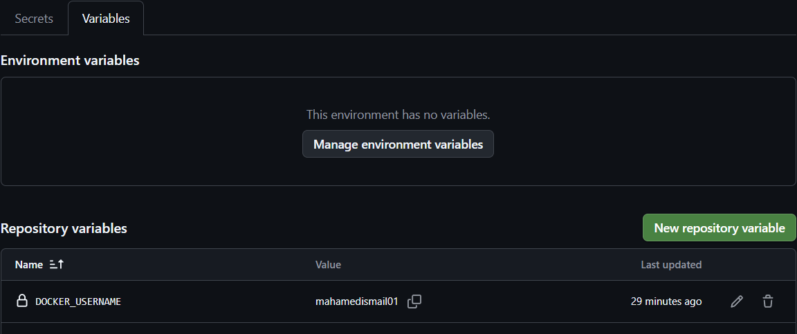
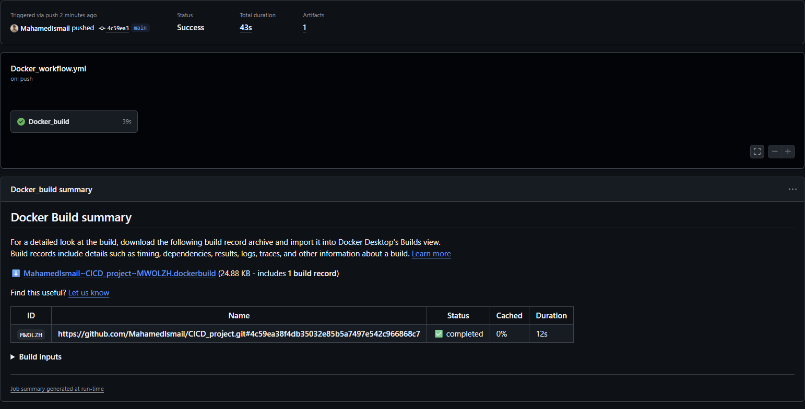
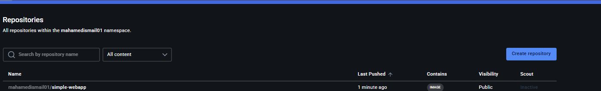
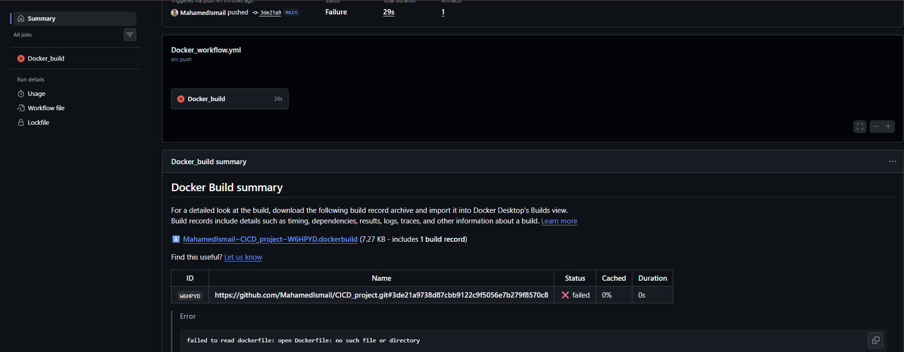
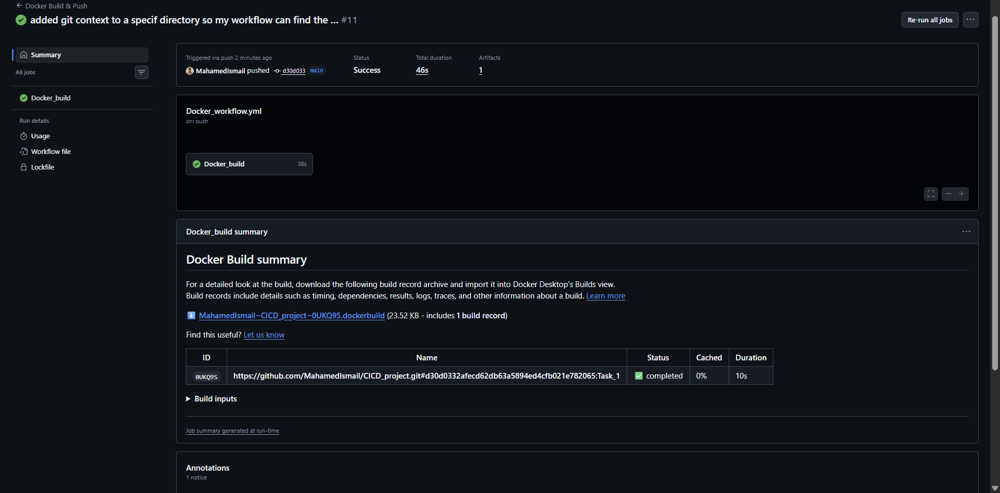
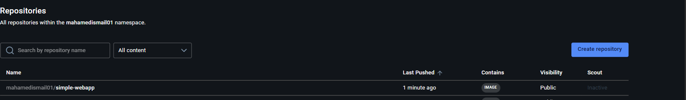

# Task 1 – Build and push a Docker image with GitHub Actions

## Purpose

The challenge: build a small web app, package it in a Docker image, and **push the image to Docker Hub automatically with GitHub Actions**, with no manual `docker push`.

This is the **CD (Continuous Delivery)** part of the module: every push to the repo builds a fresh image and publishes it to a registry, ready to be pulled and run anywhere.

**Result:** the image is published as [`mahamedismail01/simple-webapp`](https://hub.docker.com/r/mahamedismail01/simple-webapp) on Docker Hub.

### The web app

A small Flask app that shows a landing page with info about the container it runs in:



---

## Project structure

```
CICD_project/
├── .github/workflows/
│   └── Docker_workflow.yml   ← the pipeline
└── Task_1/
    ├── App/
    │   ├── hello.py          ← Flask app
    │   ├── templates/        ← HTML page
    │   └── static/           ← images (logo)
    ├── Dockerfile
    └── requirements.txt
```

---

## Prerequisites (already done for this repo)

1. **A Docker Hub account.**
2. **A Docker Hub personal access token (PAT)**
   - Docker Hub → Account settings → Personal access tokens → Generate new token
   - Permission: **Read & Write** (needed to push). Cloud Sandboxes access: **off** (least privilege)
   - The token is shown **only once**, so copy it right away

   

3. **GitHub settings** (repo → Settings → Secrets and variables → Actions)

   | Type | Name | Value |
   |---|---|---|
   | Variable | `DOCKER_USERNAME` | Docker Hub username (not sensitive) |
   | Secret | `DOCKERHUB_TOKEN` | the PAT (sensitive, shown as `***` in logs) |

   

   

---

## How the pipeline works

Triggered on every **push**. Steps:

1. **Log in to Docker Hub**: `docker/login-action`, using the variable and the secret
2. **Set up Buildx**: `docker/setup-buildx-action` (Docker's modern builder)
3. **Build and push**: `docker/build-push-action`

Key settings in the build-and-push step:

```yaml
with:
  context: "{{defaultContext}}:Task_1"
  push: true
  tags: ${{ vars.DOCKER_USERNAME }}/simple-webapp:latest
```

- **No `actions/checkout` needed.** The action uses the **Git context**: BuildKit downloads the repo itself, at the commit that triggered the workflow.
- **`:Task_1`** makes the `Task_1` folder the root of the build, so Docker finds `Task_1/Dockerfile`.
- **`tags`** is the image's full name. It decides **where** the image is pushed (no registry in front = Docker Hub).

### Result

A successful run, with the Docker Build summary:



The image on Docker Hub:



---

## Run it yourself

**Locally:**

```bash
cd Task_1
docker build -t simple-webapp .
docker run -d --name webapp -p 3000:5000 simple-webapp
```

Open **http://localhost:3000**. (`-p 3000:5000` = your computer's port 3000 → the app's port 5000 inside the container.)

**From Docker Hub:**

```bash
docker run -d -p 3000:5000 mahamedismail01/simple-webapp:latest
```

**Your own pipeline:**

1. Fork or copy the repo
2. Create your own Docker Hub PAT (Read & Write)
3. Add the `DOCKER_USERNAME` variable and the `DOCKERHUB_TOKEN` secret in your repo settings
4. Push a change → watch the **Actions** tab → check your Docker Hub repositories

---

## Errors I hit and what they taught me

| Error | Cause | Fix / lesson |
|---|---|---|
| `Username and password required` | Secret and variable were created in the **wrong repo**, so the expressions were empty | Create them in the repo the workflow runs in. A missing secret silently becomes an empty value. |
| `Identifier 'Docker build' is invalid` | Job ID contained a space | Job IDs may only use letters, numbers, `_` and `-`. Use `name:` for a display name with spaces. |
| `failed to read dockerfile: no such file or directory` | After moving the app into `Task_1`, the build context was still the repo root | Point the context at the subfolder: `"{{defaultContext}}:Task_1"` |
| Flask: `Could not import 'hello'` | The file ended up one folder deeper than `--app` expected, and the old image was still being run | Match `--app` to the real path, and **rebuild** the image after changes (`docker image inspect` shows the CMD actually stored in it) |
| Page not reachable despite `-p` | Flask listens on `127.0.0.1` by default, which inside a container means "only the container itself" | Start Flask with `--host=0.0.0.0` |

### Before and after: moving the app into `Task_1`

**Before:** the build fails because the Dockerfile isn't at the root of the build context.



**After:** with `context: "{{defaultContext}}:Task_1"`, the build finds the Dockerfile and pushes again.





---

## What I learned

- **Build context** (a Docker concept) = the files Docker can use during a build. It can be a **local path** (`docker build .`) or a **Git URL** (the Git context). `COPY . .` copies from the context into the image's working directory.
- **Git context vs path context:** with the Git context, files created or changed by earlier steps are **ignored**, because the build uses the committed code. With `context: .` + `actions/checkout`, the build uses the runner's files.
- **Tags** = the image's full address (`registry/username/repo:tag`). With no registry in front, Docker uses Docker Hub. The repo is created automatically on the first push.
- **Login `registry` input:** chooses which registry to log in to. The default is Docker Hub, so I didn't need it.
- **Secrets vs variables:** the token is a **secret** (masked), the username is a **variable** (visible, which makes logs easier to read).
- **Least privilege:** the PAT only has the permissions it needs, and can be revoked at any time.
