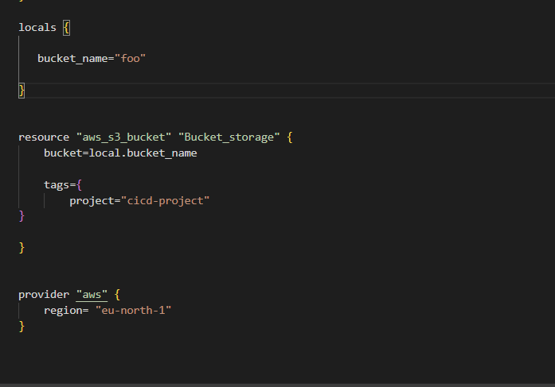
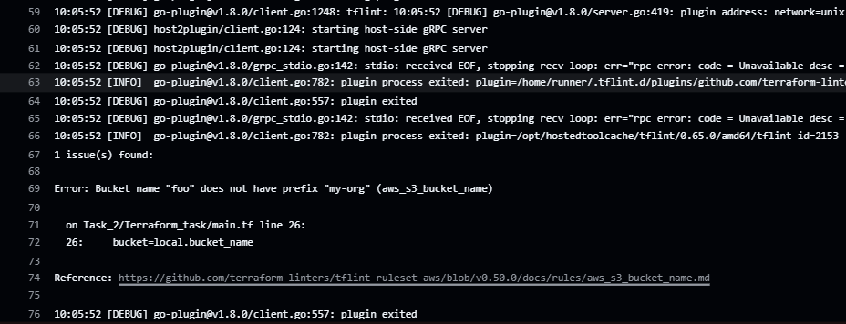
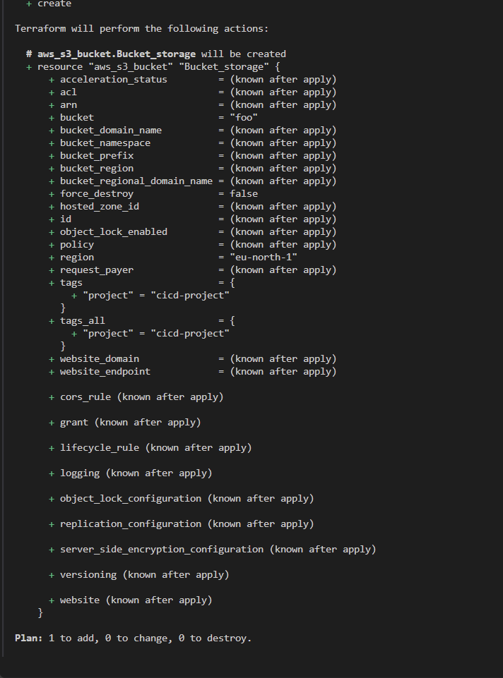
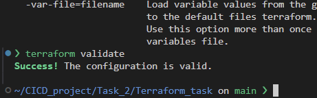
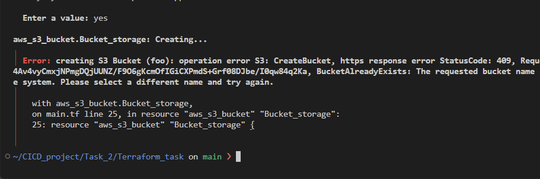
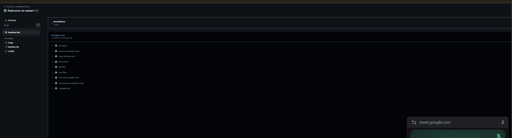
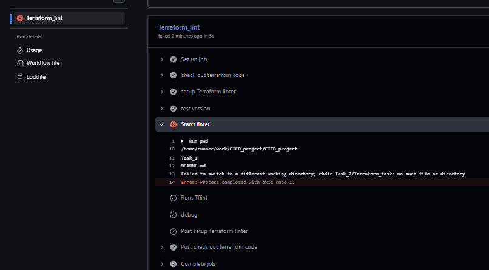

# Task 2 – Lint Terraform code automatically with GitHub Actions

## Purpose

The challenge: write some Terraform code, add errors on purpose, and build a pipeline that **checks the code automatically on every push**, so mistakes are caught **before** anything is deployed.

This is the **CI (Continuous Integration)** part of the module. Nothing is deployed here: the pipeline only **reads and checks** the code. That also means it needs **no AWS credentials**.

**Tool used:** [TFLint](https://github.com/terraform-linters/tflint), a pluggable Terraform linter that finds:

- possible errors for cloud providers (for example invalid values for AWS resources), through the **AWS ruleset** plugin
- deprecated syntax and unused declarations, through the bundled **Terraform ruleset**
- best practices and naming conventions

---

## Project structure

```
CICD_project/
├── .github/workflows/
│   └── Terraform_workflow.yml   ← the pipeline
└── Task_2/
    └── Terraform_task/
        ├── main.tf              ← Terraform code (an S3 bucket)
        └── .tflint.hcl          ← TFLint config: plugins and rules
```

---

## Prerequisites

None beyond the repo itself. Because the pipeline only lints the code, it doesn't talk to AWS, so **no secrets or credentials are needed**.

---

## The TFLint config (`.tflint.hcl`)

```hcl
plugin "aws" {
  enabled = true
  version = "0.50.0"
  source  = "github.com/terraform-linters/tflint-ruleset-aws"
}

rule "aws_s3_bucket_name" {
  enabled = true
  regex   = "^[a-z\\-]+$"
  prefix  = "my-org"
}
```

- **`plugin "aws"`** turns on the **AWS ruleset** with its default rules. It is downloaded by `tflint --init`.
- The **Terraform ruleset** is bundled inside TFLint and uses the **"recommended"** preset by default, so it needs no block.
- **`rule "aws_s3_bucket_name"`** adds a naming rule on top of the defaults. It's **off by default**, so I enabled it and configured:
  - **`regex`**: bucket names may only contain lowercase letters and hyphens
  - **`prefix`**: every bucket name must start with a fixed prefix. Like tags in AWS, this makes resources easier to manage and enforces a team or company standard.

---

## How the pipeline works

Triggered on every **push**. Steps:

1. **Checkout**: `actions/checkout` copies the repo onto the runner (TFLint needs the `.tf` files on disk)
2. **Set up TFLint**: `terraform-linters/setup-tflint`, pinned to a fixed version
3. **Check the version**: `tflint -v`
4. **Install plugins**: `tflint --chdir=<folder> --init` reads `.tflint.hcl` and downloads the AWS ruleset
5. **Lint**: `tflint --chdir=<folder> -f compact` checks the code and fails the job if it finds issues

```yaml
env:
  tfli_v: "v0.65.0"
  path: "Task_2/Terraform_task"

steps:
  - name: Check out Terraform code
    uses: actions/checkout@v7

  - name: Setup Terraform lint
    uses: terraform-linters/setup-tflint@v6
    with:
      tflint_version: ${{ env.tfli_v }}

  - name: Test version
    run: tflint -v

  - name: Start lint
    run: tflint --chdir=${{ env.path }} --init

  - name: Run TFLint
    run: tflint --chdir=${{ env.path }} -f compact
```

**Exit codes:** `0` = no issues, `2` = issues found (the step fails, which is what a CI check should do), `1` = TFLint itself had an error.

---

## Testing that it actually catches errors

**1. Make an error on purpose.** I set the bucket name to `foo`, which breaks my naming rule:



**2. The pipeline catches it:**



**3. The interesting part: Terraform itself doesn't catch it.** `terraform plan` happily plans to create the bucket:



And `terraform validate` says the configuration is valid:



That's because it **is** valid Terraform code. `validate` checks syntax and arguments; it doesn't know my naming rules.

**4. Deploying it would fail.** Running `apply` with the name `foo` fails, because S3 bucket names are **globally unique** and `foo` is already taken by someone else:



This is why testing before deployment matters. The linter enforces a naming standard (prefix + lowercase), so short generic names like `foo` never reach `apply`.

**5. Fix the name → green.** After renaming the bucket so it follows the rule, the pipeline passes:



---

## Run it yourself

**Locally** (inside `Task_2/Terraform_task`):

```bash
tflint --init     # install the plugins listed in .tflint.hcl
tflint            # lint the .tf files in this folder
```

Debug what TFLint is doing (which config it loads, which plugins start):

```bash
TFLINT_LOG=debug tflint
```

**In the pipeline:** push a change, open the **Actions** tab, and check the **Run TFLint** step.

---

## Troubleshooting: what took forever, and what I learned

The pipeline is short, but getting it to actually lint my files took a lot of debugging. These are the problems in the order I hit them.

### 1. `tflint` couldn't find my files or config

My Terraform code lives two folders deep (`Task_2/Terraform_task`), but **TFLint runs in the current directory by default**: on the runner, that's the **repo root**. There's no `.tflint.hcl` and no `.tf` file there.



**Fix:** point every TFLint command at the folder with `--chdir=<folder>`. The folder name must match **exactly** (I had `Terrafrom` vs `Terraform` at one point).

### 2. `--chdir` is not `cd`

I thought `--chdir` worked like `cd`: run it once and the next commands run in that folder. It doesn't. **It only applies to that one `tflint` command.** The shell never moves, which I proved with `pwd`: it still printed the repo root.

**Lesson:** every `tflint` command needs its own `--chdir` (or use `working-directory:` on the step, or `cd` at the start of the `run:` block, which *does* move the shell).

### 3. `--init` and lint must run in the same folder

- `tflint --init` **without** `--chdir` ran in the root, found no config, and said **"All plugins are already installed"**: there was nothing to install.
- Lint **with** `--chdir` then read my config, wanted the AWS plugin, and failed with **`Plugin "aws" not found. Did you run "tflint --init"?`**

**Lesson:** `--init` installs whatever the config **in that folder** asks for. Run init and lint against the **same** folder, init first.

### 4. False greens

A `tflint` command in the wrong folder **passes**: no `.tf` files means nothing to check, so no issues. The debug log showed it:

```
Load config: .tflint.hcl
file not found
Use default config
```

**Lesson:** a green run doesn't prove anything was checked. Test with a **deliberate error** and make sure the pipeline goes red, and check the debug log says `Config loaded`.

### 5. Bash stops at the first failing command

In a multi-line `run: |` block, GitHub runs bash in fail-fast mode. When one command failed, the rest of the step (including my debug `pwd`/`ls`) **never ran**. Indenting lines doesn't group them either; bash ignores indentation.

### 6. Small typos with confusing errors

| Error | Cause |
|---|---|
| `tfflint: command not found` (exit code 127) | typo in the command name; exit code 127 always means "command not found" |
| `--init is unknown option` | I wrote `-init` with one dash. Long options need **two** dashes (`--init`); one dash is for single letters (`-v`, `-f`) |
| `cat: ~/.tflint.d/plugins: No such file or directory` | the plugin folder only exists **after** `--init` has installed something, and `cat` can't read folders anyway (use `ls`) |

### 7. The folder vanished from the runner

At one point `ls` on the runner showed `Task_1` but no `Task_2`: I had deleted it by mistake in an earlier commit. **The runner only gets what's committed.**

```bash
git log --oneline -- Task_2                            # find the commit that deleted it
git restore --source=<deletion-commit>^ -- Task_2      # bring it back from the commit before
```

### 8. What TFLint does *not* check

- **Formatting** (indentation, spacing) → that's `terraform fmt -check`
- **Every argument being valid**, e.g. a typo like `ags` instead of `tags` → that's `terraform validate`
- **Things no rule covers**, e.g. a wrong `region` in the `backend` block → only `terraform init` notices

TFLint only checks what its rules cover. The three tools complement each other: **`fmt` for style, `validate` for correctness, TFLint for cloud errors and best practices.**

### 9. Terraform state lessons (side quest)

- `.terraform/terraform.tfstate` is **not** your state. It's the backend settings `terraform init` saved (bucket, key, region). The real state has a `"resources"` list and lives in the S3 backend.
- The state file is only written to S3 on the first `apply`, not on `init`.
- After changing the `backend` block, `init` asks for **`-reconfigure`** (switch, nothing to copy) or **`-migrate-state`** (copy existing state over).
- Don't let a config **create the same bucket it stores its state in**. Create the state bucket separately.

---

## Next improvements

- Add `terraform fmt -check` and `terraform validate` (with `hashicorp/setup-terraform`) next to TFLint
- Only run the workflow when Terraform files change, with a `paths` filter on `push`
- Run the checks on **pull requests** too, so bad Terraform is blocked before it's merged
